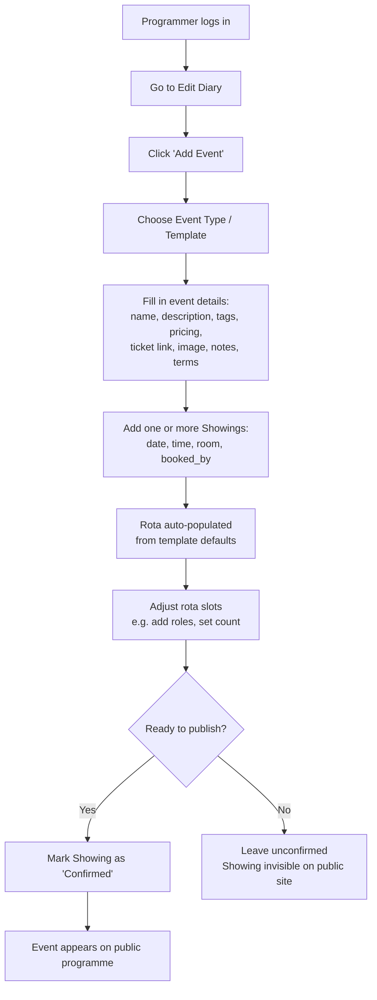
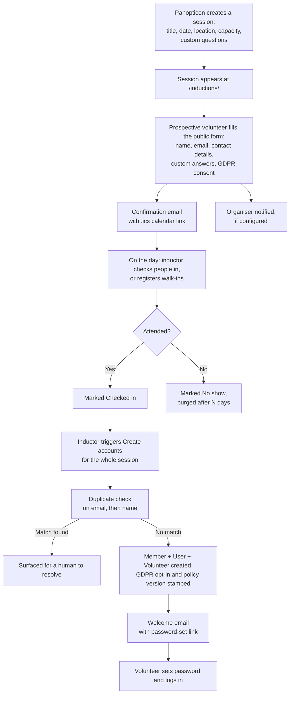
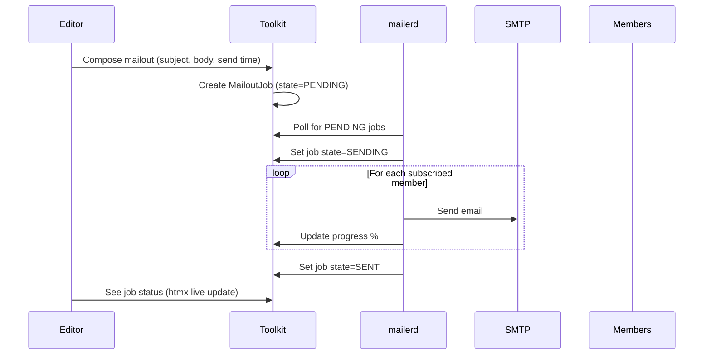
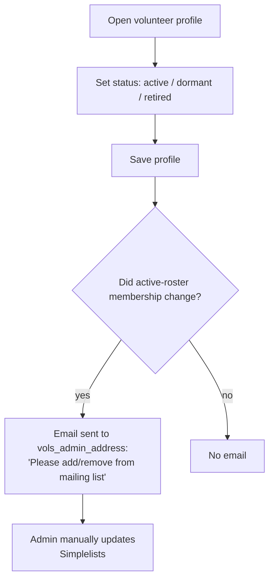
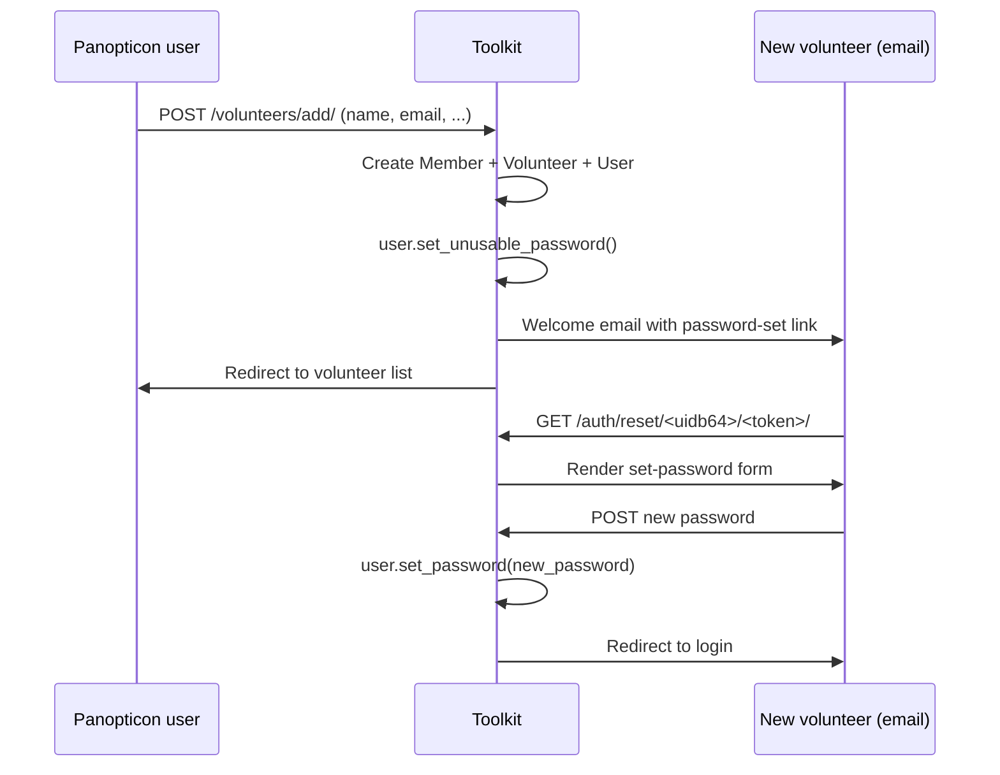
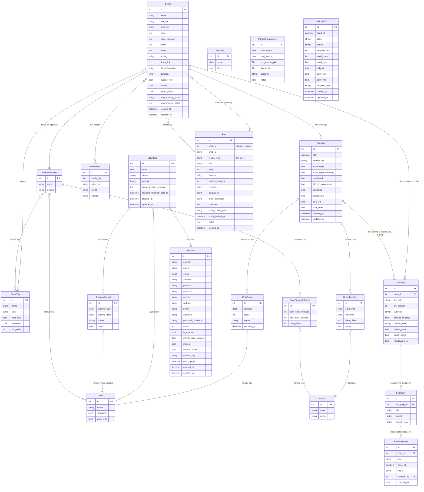
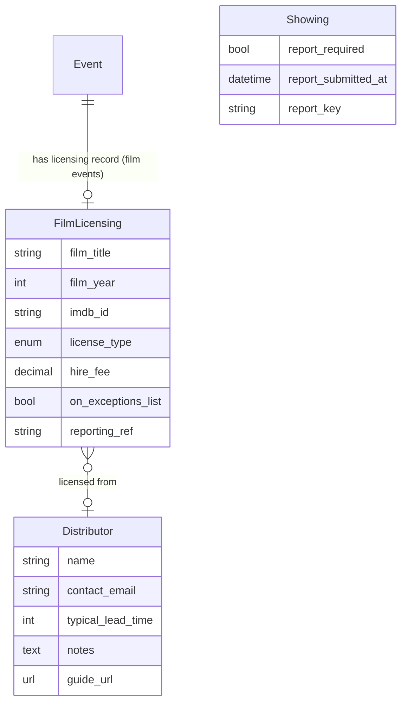

# Star and Shadow Cinema — System Specification

**Author:** Jonny Kram, with agentic AI assistance (Claude by Anthropic)

**Audience:** This document is for a developer (experienced or volunteer) who wants to understand what the current system does, and/or rewrite it from scratch in any language or framework. It is written to be implementation-agnostic. It's also written to double as a context primer for AI tools working on this codebase, so they can see what's built versus where the project is headed without re-deriving it each session. These two jobs pull in different directions, and where that tension shows up as a section reading like both a spec and a briefing note, that's a known, unresolved trade-off rather than an oversight.

**Scope:** This file describes the system **as built**. Design rationale and specifications for proposed (unbuilt) features live in [TASKS.md](TASKS.md). Task status and roadmap live in [CURRENT_WORK.md](../CURRENT_WORK.md).

**Context:** The Star and Shadow Cinema (Newcastle upon Tyne) is a volunteer-run organisation with an anarchist ethos. The system described here manages events, volunteers, and communications. This specification represents the author's understanding of the system and the values that should guide its development, offered for collective review and consensus.

**On AI assistance:** I have used AI tools extensively in writing this document and in developing code for the toolkit. My reasoning for this choice, and some thoughts on the tensions it creates, are discussed in the principles section below.

---

## Table of Contents

- [Principles and values](#principles-and-values)
  - [On the use of AI tools in development](#on-the-use-of-ai-tools-in-development)
  - [Relationship with the Cube Microplex](#relationship-with-the-cube-microplex)
  - [The value of volunteer time already invested](#the-value-of-volunteer-time-already-invested)

1. [What the system does](#1-what-the-system-does)
2. [Who can access what — permission model](#2-who-can-access-what--permission-model)
3. [Business rules and invariants](#3-business-rules-and-invariants)
4. [Key workflows](#4-key-workflows)
5. [Should we just use Squarespace?](#5-should-we-just-use-squarespace)
6. [External integrations](#6-external-integrations)
7. [Integration with adjacent infrastructure](#7-integration-with-adjacent-infrastructure)
8. [Data model](#8-data-model)
9. [URL / endpoint map](#9-url--endpoint-map)
10–12. Rewrite strategy, technology notes, and data migration: dead; the path taken was a Django→Django port, not a ground-up rewrite. Kept as historical record at [ARCHIVE/REWRITE_STRATEGY.md](ARCHIVE/REWRITE_STRATEGY.md)

*Proposed features and design rationale: docs/TASKS.md · Status and roadmap: CURRENT_WORK.md*

---

## Principles and values

This specification describes the system as it exists and the values that guide its development. It reflects the Star and Shadow's ethos as I understand them; specific technical implementations are working proposals until ratified by the collective.

> Star & Shadow Cinema is a completely volunteer-run DIY venue based in Newcastle upon Tyne in the North East of England.
>
> We are an arts, music, cinema and community space set up as a cooperative that anyone can join.
>
> No-one is paid to run the Star & Shadow. There are no bosses or managers, just working groups, collective meetings, consensus decision making and a heavy dose of honest disorganisation. The building is run and programmed by its members and volunteers.
>
> Our programming is completely open. Anyone willing to volunteer can put on a film screening, gig, meeting, talk or party, as long as they are willing to help run the place and get involved.

**No bosses or managers.** The system must not reproduce hierarchy in its UX. Avoid features that amplify one voice over another or require gatekeepers for routine actions. Coordination roles (Panopticon, Programmer) represent responsibilities, not authority. Spontaneous hierarchies do emerge, typically due to knowledge differentials, but everyone has a right to claim this space as their own.

**Consensus and collective decision-making.** The toolkit facilitates coordination; it does not impose process. For example, the programming pipeline (9.2) supports how Monday meetings actually work rather than enforcing a rigid approval hierarchy.

However, processes that the collective *has* agreed to sometimes need to be encoded in the system to have any teeth at all. A space genuinely open to anyone is also open to bad actors, and S&S does a good job of self-governing -- but a collectively agreed safeguard that exists only as a social norm is vulnerable to whoever is least willing to honour it.

My proposed design principle is therefore not "never enforce anything" but **"only enforce what the collective has agreed to enforce."** Where a restriction exists (e.g. finance thresholds), it should be possible to point to the collective decision behind it. Where no such decision exists, the system should nudge rather than block.

**Honest disorganisation.** The system must be tolerant of incomplete data, half-finished entries, and tasks left undone. Strict validation that blocks progress will be worked around or ignored. Soft warnings beat hard blocks. Lots of us are volunteering in our spare time and just want to get things done, it's important to respect that.

**Anyone can get involved.** Low barrier to entry is a core value. The rota, the programme, and the volunteer onboarding process must be accessible to someone with no technical background who has never used the system before.

**The toolkit as community space.** The toolkit is not just a management tool - it is a shared space that the community contributes to and inhabits. In some ways it is a direct descendant of the paper sign-up sheet that preceded it: a place where people show up, put their name down, and find out what's happening. This lineage matters. The lo-fi, low-demand quality of the current system is not a limitation to be overcome - from what I've observed, for some members it is actively valued, as a counterpoint to the polished apps and notification-heavy platforms that dominate the rest of their lives and demand their attention on someone else's terms.

People spend significant time on the rota not because the system nudges them to, but because they care. That voluntary engagement is precious and should not be undermined by features that make the toolkit feel like a productivity system or a managed service.

There are 1,500 registered volunteers and typically around 100 active at any one time. Disagreements happen. Tensions arise. The fact that the place functions as well as it does - without bosses, without HR, and with formal dispute resolution mechanisms that have real limits on how quickly and strictly they can be applied - is an ongoing collective achievement. The toolkit should support the human processes that make this possible, not try to automate over them.

For many volunteers, the Star and Shadow is one of the only spaces where they feel able to be their full selves, separated from the disempowering systems and hierarchies of daily life. The toolkit exists in service of that space. Any feature that affects how people encounter each other (notifications, social signals, automated messages, visibility of who has or hasn't done something) should be designed with the community's social fabric in mind, and introduced with care.

**Social capital and intentional friction.** Star and Shadow runs on a social economy where time is currency and relationships are the medium of exchange. Even couching it in terms normally used to describe capital systems feels a bit gross. Some friction is intentional, or if not intentional, has started accidentally fulfilling a useful role. For example, requiring a new programmer to personally approach keyholders is a form of community vetting. Automating this away entirely removes a useful social check.

**Volunteer maintainability above all.** A system that disempowers us from taking ownership of it and making our own changes has failed. Prefer simple, well-documented code over sophisticated abstractions. The ideal is a codebase that an enthusiastic volunteer with some Python experience can confidently read, run, and modify.

The same principle applies at the collective level. Groups self-assemble around a shared interest and develop their own internal cultures. The fact that their membership is not always visible to the outside world is sometimes by design. The toolkit should not force collectives into the open without a collective decision to do so.

### On the use of AI tools in development

**This section represents my (Jonny Kram's) personal position on using AI tools for this project. I have not sought collective agreement on this, and I'm aware that some members may disagree with my approach.**

I recognise that some members of the community may have ethical objections to the use of AI tools in developing or maintaining the toolkit. I have many of these ethical objections myself. These objections are worth taking seriously - they may relate to the environmental cost of AI inference, concerns about training data and intellectual property, the displacement of paid technical labour, or the concentration of AI capability in large corporations whose values may not align with the Star & Shadow's.

That said, I've been meaning to get into web development for ~15 years and never managed it, and wouldn't have been able to do much of the work in this project without AI assistance. It would have taken an order of magnitude more work and effort, resources that I don't have to spare while managing my health.

**Accessibility.** My view is that the principle that "anyone willing to volunteer should be able to get involved" extends to the codebase itself. AI coding tools meaningfully lower the barrier to contributing for people who have enthusiasm and ideas but lack formal software training, or who work in adjacent fields and would find the learning curve too steep to donate their time otherwise. A volunteer who can describe what they want in plain language and iterate on the result with AI assistance can make real contributions that would otherwise be impossible for them. In my view, rejecting AI tools uncritically can reproduce the same gatekeeping the collective tries to dismantle elsewhere. Making the codebase easily deployable and tinkerable - with Docker containers, seed data, and good documentation - is a fantastic way to lower the barrier to entry, and AI assistance is a powerful tool for achieving that.

**Pragmatism.** Professional software development is expensive. Skilled developers who could build this system commercially are rare in a volunteer pool, and those who do volunteer are giving time that is genuinely costly to them. In my case, the realistic alternative to AI-assisted development is often not "I do it without AI": it is "it doesn't get done." If AI assistance is what makes a feature possible at all, that is worth weighing honestly against the ethical concerns.

This is not an argument to dismiss those concerns; it is my reasoning for why I have chosen to use AI assistance for this work. I recognise that others in the collective may weigh these considerations differently. I have tried to be transparent about this throughout: any file where AI assistance shaped the logic or structure carries an `ai-contributors` tag in its header, so the disclosure travels with the code rather than sitting only in a commit history that gets rewritten or squashed over time. If the collective decides it does not want AI-assisted contributions, I will respect that decision, but I wanted to document my reasoning openly.

For clarity: the toolkit itself does not and should not depend on AI or machine-learning capabilities to function. Any AI-assisted tooling sits in the development process, not in the running system.

### Relationship with the Cube Microplex

The toolkit codebase was originally written for, and continues to be maintained by, the **Cube Microplex** in Bristol. The Star and Shadow runs a fork of the same codebase. This relationship is worth taking seriously in both directions.

**Being good neighbours.** Both organisations are volunteer-run arts cinemas with anarchist and co-operative values. Any improvements the Star and Shadow makes to the shared codebase could benefit the Cube: particularly generic improvements (performance, accessibility, GDPR tooling) that aren't S&S-specific. The right posture is: when we fix something that is clearly a bug or a general improvement, open a pull request upstream. Don't assume the Cube wants or needs our feature set. Do offer the ones that would translate cleanly without imposing cognitive overhead on their team.

**Not assuming our way is better.** The Cube operates quite differently: it uses Celery and Redis for background tasks; it has a different membership structure, different venue configuration, and different volunteer workflows. The fact that we've built something one way doesn't mean that's the right way for them. Features developed here should be configurable (behind settings flags) rather than hardcoded, so both sites can adopt or ignore them independently.

**Technical caution.** The Cube's production deployment uses the `master` branch directly. Any changes merged there affect their live site. The Star and Shadow should develop on its own branch (`sns_2026_overhaul` or equivalent) and offer carefully reviewed changes upstream, not push directly to master with S&S-specific assumptions baked in.

### The value of volunteer time already invested

This codebase represents roughly **15 years of volunteer and subsidised development** (from the first commit in July 2011 to the present day).

A few numbers from the git history:

| Metric | Value |
|---|---|
| Total commits (all branches) | 1,877 |
| Years of active development | 2011 – present (most active: 2012, 2014, 2017) |
| Primary contributor | Ben (~1,434 commits) |
| Second contributor | Marcus (~234 commits) |
| Lines of Python code | ~21,000 |
| Lines of HTML templates | ~5,300 |

At a UK freelance developer rate of **£400/day (~£50/hour)**, and estimating from commit volume and lines of code, very roughly, at **1,500–3,000 hours** of skilled development time:

> **£75,000 – £150,000 of development work has been donated or subsidised into this system.**

This figure is a rough estimate, not a costing, and it values one specific thing: the codebase as **inherited**, built by Ben, Marcus and others before this project's 2026 rewrite, using the git-history metrics in the table above. It is not a running total. A further, unquantified amount of my own time has gone into porting and extending that inherited base since, on top of the baseline this number describes, and that additional work isn't counted here at all. What the number represents is real, even loosely measured: many evenings and weekends from developers who gave their time because they believed in what the Cube and S&S are doing. When volunteers contribute code or documentation, they are continuing a tradition of generosity that deserves recognition.

For the same reason, the effort estimates throughout TASKS.md are given in commercial freelance rates, not as a budget - but as an honest acknowledgement of what volunteers are giving when they contribute technical work. A volunteer who implements the break-even calculator (estimated 2–4h) is donating £100–£200 of skilled labour, not just "a few hours on a weekend".

---

## 1. What the system does

The system (internally called "the Toolkit") has seven distinct areas of functionality:

### 1.1 Public programme listing

A public-facing website showing upcoming events. Visitors can:
- Browse events by date, week, month, year, or tag (category)
- Read full event descriptions and see images
- Follow an RSS feed of upcoming events
- Search an archive of past events
- View a direct link to an individual event or showing
- Access static content pages (About, Contact, etc.) managed via a CMS

### 1.2 Event and diary management (internal)

Logged-in users can:
- Create and edit events (title, description, pricing, tags, images, terms)
- Schedule one or more showings (date/time/room) per event
- Manage event templates (reusable defaults for recurring event types)
- Manage tags and roles
- View and edit a calendar of events
- Upload PDFs of printed programmes to an archive
- Write monthly free-text "ideas" notes
- Confirm or cancel showings; hide showings from the public programme

### 1.3 Volunteer rota (internal)

- Each showing has a rota: a list of role slots (e.g. "Bar Staff", "Projectionist")
- Each slot can be filled with a volunteer's name (currently stored as free text)
- A rota view shows all showings in a time range with their role slots
- A "vacancies" view highlights unfilled slots
- Roles can be marked as "standard" (shown on the main rota list) or non-standard

### 1.4 Member and volunteer database (internal)

- **Members**: the underlying record for anyone in the system (subscribers,
volunteers). Stores name, email, address, phone, pronouns, notes, GDPR consent date. At Star and Shadow, the formal "membership" distinction is not used: everyone is treated as a volunteer, not a paying member.
- **Volunteers**: the active layer on top of a Member record (portrait photo, lifecycle status, qualified roles). See §[Volunteer status, login access and suspension](#volunteer-status-login-access-and-suspension) for the full status model.
- **Training records**: structured logs of who was trained for which role, when, and by whom. See §[TrainingRecord](#trainingrecord) for why these aren't actively maintained in practice.
- Add/edit volunteers and set their status (active / dormant / retired / suspended) on the profile page, with automatic notification emails to admins when a volunteer joins or leaves the active roster
- CSV export of volunteer list
- Reports: volunteer list, role-by-volunteer report, training records report

### 1.5 Email mailouts (internal)

- Compose an email (plain text and/or HTML) to be sent to all subscribed members
- Schedule it for a future time
- A background daemon picks up scheduled jobs and sends them
- Job queue with real-time progress (htmx polling)
- Cancel a pending or in-progress job
- Members have a unique unsubscribe token for one-click unsubscribe links in emails

**Note (Star and Shadow):** at S&S the toolkit mailout system is used for the members list. Volunteer communications typically go through Simplelists mailing lists, managed outside the toolkit, though some users still use the members list. There also may be members who aren't volunteers, grandfathered in - these are people who have signed up to get communications from the Star & Shadow but haven't got corresponding volunteer accounts. Requires access to Panopticon level / raw database to check. See section 4.3 for the workflow diagram.

### 1.6 CMS content pages (internal)

- Wagtail-powered CMS for "About", "Contact", and other static pages
- Managed by editors via a web admin interface
- Pages can be linked from the public programme listing

### 1.7 Volunteer inductions (public + internal)

- Panopticons schedule induction sessions with a date, location, capacity and custom questions
- Prospective volunteers browse open sessions and sign up publicly, with GDPR consent captured at the point of submission
- A separate access-needs request form routes people who cannot use a regular session towards a 1:1
- On the day: check-in, walk-in registration, and no-show marking
- Afterwards: bulk creation of `Member`, `User` and `Volunteer` records from the attendees, each sent a welcome email with a password-set link
- Off by default (`InductionsSettings.inductions_enabled`), and not yet running in production. See §4.2.

---


## 2. Who can access what — permission model

The system has three permission tiers:

| Tier | Django permissions | Distinguishing check | What it allows |
| --- | --- | --- | --- |
| **Volunteer** | `diary.change_rotaentry` | — | Edit the rota. Cannot create/edit events, see member data, or use the CMS. |
| **Programmer** | `toolkit.write` + `toolkit.read` + `diary.change_rotaentry` | `perms.toolkit.write` | Everything a volunteer can do, plus: create and edit events and showings. Access to diary list, calendar, programming queue, event templates/tags, roles, rooms, reports, printed programmes, and donations management — **each individually configurable** (see below). |
| **Panopticon** | same as Programmer + `is_superuser = True` | `user.is_superuser` | Full access: everything a programmer can do, plus: website edits via Wagtail CMS, access to sensitive volunteer and member data (names, emails, addresses, notes), adding and retiring volunteers, sending mailouts. Also controls site settings (including permission levels). Intended for a small group of trusted coordinators. |

Authentication is via Django's built-in session-based auth (username + password). There is no public registration.

The `CUBE_IP_ADDRESSES` setting defines a list of IP addresses that bypass the login requirement for the "add new member" page (intended for use at the venue's front desk). This should be replaced with a proper role-based check: see [Known limitations](#known-limitations).

Volunteers with the `Programmer` BooleanField set on their profile are automatically added to the `Programmers` Django group, which grants `toolkit.write` + `toolkit.read`. Panopticon (`is_superuser`) is assigned manually by an existing superuser.

**Runtime-configurable feature access (9.49):** The following features have a `perm_*` field on `SiteConfiguration` that Panopticons can adjust at runtime via Site Settings, without a code deploy. Each defaults to `PERM_PROGRAMMER` (`toolkit.write` check) except `perm_rota_vacancies` which defaults to `PERM_VOLUNTEER`.

| `SiteConfiguration` field | Feature |
| --- | --- |
| `perm_diary_edit` | Diary edit list |
| `perm_diary_calendar` | Calendar edit view |
| `perm_programming_queue` | Programming queue |
| `perm_event_templates` | Event templates (list + detail; import always Panopticon) |
| `perm_event_tags` | Event tags |
| `perm_roles` | Roles edit |
| `perm_rooms` | Rooms edit |
| `perm_diary_reports` | Copy, terms, and text reports |
| `perm_printed_programmes` | Upload printed programmes |
| `perm_rota_vacancies` | Rota vacancies page (default: All volunteers) |
| `perm_donations_manage` | Donations manage |

The `feature_required(feature_name)` decorator in `toolkit/toolkit_auth/decorators.py` reads the level at request time from the cached `SiteConfiguration` singleton. The `feature_perms` context variable (computed in `diary_settings` context processor) exposes the same checks to templates so nav links are hidden for features the current user can't access.

**Access audit trail:** When Panopticon or Programmer access is granted, a `PanopticonGrant` or `ProgrammerGrant` record is created (models in `toolkit/members/models.py`). Each grant stores the granting user, a mandatory reason (Panopticon only), and the date granted. `PanopticonGrant` also tracks last-reviewed date and reviewer. Access grants are visible to all logged-in volunteers at `/toolkit/access/`: a transparency page that also explains what each tier can do in plain language. Panopticon users can mark their own grants as reviewed; reviews are considered overdue after 365 days without a review.

**Film readiness (9.174): a narrower, fourth path.** Recording that a film step is done, or claiming it ("I'll test this"), is open to Programmer+ *and* to any volunteer who holds, or in the last 180 days held, a rota entry on a `Role` with `is_projectionist` set. That volunteer needs no toolkit permission: rota-only volunteers have none, and the dashboard asks only for a login. The two endpoints (`film-milestone-claim`, `film-milestone-complete`) use `film_update_required` for this; everything else in the feature (the edit page, the Event Hub panel) stays Programmer+. Someone who is both a programmer and a projectionist takes the Programmer+ branch, so it is one permission check, not two roles. The read-only overview page (`film-readiness-overview`) is different: any logged-in volunteer may view it, with no permission check beyond login, so people thinking of becoming programmers can see how the process works first. It shows volunteer display names (9.170), never usernames or private names, and links through to the Hub only for Programmer+. The whole feature 404s while `SiteConfiguration.film_prep_enabled` is off.

### Known limitations

- **Free-text rota names.** `RotaEntry.name` is a plain string, not a link to `Volunteer` (§3 rule 4). The system has no automated way to see a volunteer's full rota history or contact them about a booking.
- **One training model, several kinds of eligibility.** A single `TrainingRecord` model backs every role (§3 rule 13), but real eligibility ranges from tiered internal training to external certification to informal shadowing. The model fits none of them well.
- **IP-based bypass for adding members.** `CUBE_IP_ADDRESSES` grants unauthenticated access to the "add new member" page from listed addresses, intended for front-desk use. A proper role-based check would be safer.

---


## 3. Business rules and invariants

These are rules enforced by the current system. A rewrite should preserve them.

1. **Events cannot be deleted.** Once created, an event record persists forever.
Showings can be cancelled, and events can be hidden, but the event record remains. (This is a data integrity and audit trail decision.)

2. **Past showings cannot be edited or deleted.** A showing with a start time in
the past is locked. (Applies at the application layer; not a database constraint.)

3. **Read-only Roles and EventTags cannot be modified or deleted.** Certain system
roles (e.g. "Keyholder") are marked read-only. They can only have their `promoted`/`sort_order` fields changed.

4. **Rota volunteer names are free text.** The `RotaEntry.name` field is a plain
string, not a foreign key. Volunteers sign up (or are signed up) by name, but the system has no way to verify the name or link it back to a volunteer record.

5. **Volunteer training auto-adds roles.** When a role-specific training record is
added for a volunteer, the system automatically adds that role to the volunteer's `roles` set. *In practice at Star and Shadow, training records are not maintained and this link is not relied upon.*

6. **Training records expire.** By default, a training record older than 12 months
is considered expired (configurable via `DEFAULT_TRAINING_EXPIRY_MONTHS`). *In practice at Star and Shadow, expiry is not enforced and does not gate access to roles.*

7. **Membership numbers are based on database primary keys.** A member's
user-facing number is set to their database `id` (with collision avoidance). *At Star and Shadow the membership number concept is not used in practice.*

8. **Showing start times must be in the future.** A showing cannot be scheduled
in the past (validated at form submission).

9. **Events must have terms text before confirmation** (configurable, and exempted
for meetings and training events via `TAGS_WITHOUT_TERMS`).

10. **Showings are only public when `confirmed=True`, `event.private=False`, and `hide_in_programme=False`.**

11. **New volunteer and retirement actions trigger admin notification emails.** The system emails `vols_admin_address` but does not directly manage the external mailing list.

12. **Mailout recipients:** a member receives mailouts only if `mailout=True`, `email` is non-empty, and `mailout_failed=False`.

13. **Role eligibility is real but varies by type.** Different roles have meaningfully different qualification requirements. These are not currently enforced by the system, but a rewrite should be designed with them in mind. The qualification types are:

    | Role | Gate type | Notes |
    |---|---|---|
    | **Projectionist** | Internal tiered training | At least 1 level, possibly 2–3. Progression through levels tracked internally. |
    | **Bar** | Induction — training + licensing | A specific bar induction is required before anyone can work behind the bar, for both training and legal/licensing reasons. |
    | **Food (Level 1)** | Induction — in-house café induction | Monthly café inductions cover kitchen layout, venue procedures, and food hygiene basics, and grant participants a Level 1 food hygiene certificate. Required for most café roles. |
    | **Food (Level 2)** | External certification | UK Food Hygiene Level 2 certificate, obtained externally. Required for roles involving direct handling of food. |
    | **Sound / tech** | Informal — self-selected | No hard rule. Volunteers generally shadow a number of times before taking a role independently. |
    | **Keyholder** | Nomination and acceptance | A position of trust. Requires nomination, acceptance by the collective, and broad venue competency (keyholders may need to support any other role if someone no-shows). Not gated by a single training event. |

The current system uses a single `TrainingRecord` model for all of these, which fits none of them well: see [Known limitations](#known-limitations).

14. **Programming eligibility is a collective norm, not a system gate.** The collectively agreed expectation is that a volunteer does approximately 10 shifts (and at least 5 in the preceding 6 months) before programming their own event. This is documented in the programming etiquette guide but is not, and should not be, enforced by a hard system lock. Reasons: (a) rota names are free text, so the system cannot reliably count a volunteer's past shifts (see [Known limitations](#known-limitations)); (b) enforcing a gate would be contrary to the non-hierarchical ethos; (c) the collective is the appropriate enforcement mechanism, not software. The right toolkit response is to surface this guidance prominently at the point of event creation (see section 9.2), not to block.

15. **Events with estimated costs above threshold require Finance Collective sign-off.** Events costing over £500 (£750 for music events) must be referred to the Finance Collective for authorisation before confirmation. This is a collectively agreed spending control. The system should flag this threshold in the programming pipeline view (see section 9.2), but the final authorisation is a human process, not a database lock.

---


## 4. Key workflows

### 4.1 Creating an event and scheduling showings



### 4.2 Volunteer induction

This branch has a built induction workflow in the `inductions` app: capacity-limited sessions, public sign-up, check-in on the day, and bulk account creation for everyone who attended.

It is gated behind `InductionsSettings.inductions_enabled`, which ships **off**, so every public induction URL returns 404 until a Panopticon turns it on. That default is deliberate. A venue still taking sign-ups through Google Forms should not silently acquire a second, competing front door.

**Not in production.** Live Star and Shadow runs the `s+s` branch, which has no `inductions` app, so the process there is still the manual one: a Google Form, admins verifying attendance by hand, and a Panopticon re-typing the details into Volunteers → Add Volunteer. That manual route also still exists on this branch, unchanged, at `/volunteers/add/` (§4.6), and remains the right path for anyone joining outside a scheduled induction.



Key behaviours a developer should know:

| Piece | Detail |
|---|---|
| **Feature flag** | `InductionsSettings.inductions_enabled`, default off. Gates every public URL in the app. |
| **Session types** | Regular, small group, and 1:1 for access needs. 1:1 sessions are excluded from the public listing, since they are arranged rather than browsed. |
| **Capacity** | `max_signups` per session, falling back to `default_max_signups`. A full session renders a "session full" page in place of the form, and organisers can be emailed when one fills. |
| **Consent** | The sign-up form carries a mandatory consent checkbox naming exactly what is stored, the retention period, and a link to the privacy policy. `privacy_policy_version` is stamped onto the `Volunteer` at account creation. Marking the policy updated bumps that version, flags everyone who consented to an earlier one, and emails them. |
| **Access needs** | A separate public form at `/inductions/access-needs/`, independently toggleable, for people who cannot use a regular session. It creates an `InductionRequest` that organisers triage towards a 1:1. |
| **Retention** | Pending and no-show sign-ups are purged `induction_purge_days` after the session date. |
| **Account creation** | Bulk, over every checked-in sign-up that has no volunteer record yet. Looks for an existing volunteer by email and then by name, and surfaces matches for a human to resolve rather than quietly creating a duplicate. |
| **Emails** | Confirmation, reminder, welcome, and access-needs acknowledgement. Subject and body are each overridable in Site Settings, with documented substitution variables. |

**The audit-trail gap is closed.** `InductionSignup.checked_in_by` records who checked each person in, `InductionSession.created_by` records who ran the session, and the account-creation step logs the acting user per volunteer created. "Who inducted whom" is now answerable, which it was not under the Google Form process.

**One gap remains: no mailing-list notification on this path.** `_create_volunteer_from_signup` builds the `Member`, `User` and `Volunteer` records directly and does not fire the `vols_admin_address` "please add to the mailing list" email that the manual `/volunteers/add/` path sends (§4.6, step 4). A volunteer who joins through an induction is therefore invisible to whoever maintains Simplelists, unless someone thinks to tell them. This is the automated flow reintroducing the exact failure [known-issues.md §8.5](tasks/known-issues.md) describes, and it matters more here than on the manual path, because bulk creation means a whole cohort can go unnoticed at once.

### 4.3 Sending a mailout



### 4.4 Volunteer retirement

Retirement (and dormancy, and reactivation) is done by changing the volunteer's **status** on their profile page: there is no separate retire/unretire workflow. `status` is the single source of truth; whenever an edit moves a volunteer on or off the active roster, an admin notification fires.



### 4.5 Film programming in Toolkit

Full workflow (proposing, licensing, TicketSource, on-the-day, promotion): [how-to-programme-a-film.md](how-to-programme-a-film.md). This section covers only what constrains the software itself.

Programming runs in four seasons: **Spring** (March–May), **Summer** (June–July), **Autumn** (September–November), **Winter** (December–February). Thursdays and Sundays from 19:30 are reserved for film and TV screenings; other times need approval from the main Programming Group.

Each proposal requires a **25-word summary or pitch**, used unchanged for the print programme and submitted to *The Crack* and *NARC* magazines; the length matters because there's no re-editing it downstream. See section 9.16 for the proposed live word counter UI feature.

Toolkit fields for a film event:

| Field | Notes |
|---|---|
| Room | Cinema |
| Start | Usually 19:30 on the screening date |
| Event name | Film or TV show title |
| Event template | Choose closest format to the screener |
| Pricing | Typically £7/£5/£3/£0 (Full / Concessions / Further concessions / Free) |
| Ticket link | Add after TicketSource setup — can return to diary entry at any time |
| Film information | Dir. (Director), Year, Country, Runtime (mins), BBFC rating |
| Programmer's notes | Private notes, only visible to volunteers |
| Copy | Public-facing event description |
| Terms | Distributor name and licence fee |
| Image | Distributors provide licensed images; Filmbank account gives access to film poster scans. Avoid Google Images: copyright risk. |

Once the TicketSource link is added, mark the showing **Confirmed** to make it live.

**Film readiness (9.174, behind `film_prep_enabled`).** Getting the film into the booth in working order is a handover between whoever sourced it and whoever runs it. The unit is one *film*, linked to the showings it plays at: a run of one film is one film on all its showings; Family Film Club, which shows a different film each date, is one film per date; a double or triple bill is two or three films on the same showing, each with its own state. A film that accompanies another event (a film with Community Kitchen) is programmed as an event of its own, which also puts it on the public programme. On the Event Hub a "Film readiness" panel shows one block per film, with each *copy* (main, backup) and a format-dependent list of steps: a disc is in the building, in the booth, test-played; a DCP is on FilmVault or its hard drive has arrived, then ingested, then test-played; an MP4 is in the building, then test-played. Each step records who did it and when, and anyone permitted (see §2) can claim one ("I'll test this on Thursday") so it is visible that someone has said they will. Claims and completions land in the Hub audit trail. A film is ready as soon as any one copy is ready, so a working backup covers a failed main copy. Dates of a film event with no film recorded are flagged on the Hub, the overview and the programmer's dashboard. Hired hard drives have a return leg after the film's last showing (sent back by courier, then confirmed by the distributor), tracked separately from readiness and surfaced as a "Hard drives to send back" list on the overview and a dashboard card, so drives do not pile up. Post-run financial reporting is out of scope here and stays in 9.171. A read-only **overview page** lists every upcoming film, soonest first and in every state, ready ones included, with each copy's steps, who did or claimed what, the bill it is on, subtitles, and whether a backup is in place and where it is. Two dashboard cards surface it, each linking to the overview, and anyone with neither card gets a small standing "Film readiness" card instead: "Your films" (films on events the viewer programmes, any status) and "Films needing a test" (untested films in the next 7 days, for Programmer+ and projectionists, excluding the viewer's own films so nothing appears twice). A **Films** link in the toolkit navbar and command palette leads to the overview. No email or scheduled nudges yet. Which format to choose is guidance that lives elsewhere; `film_sourcing_guide_url` links to it.

### 4.6 Volunteer user accounts and password setup

Every volunteer gets a Django `User` account. This section documents how accounts are created, how volunteers set their initial password, and the flows for resetting or directly setting a password later.

---

#### Account creation (automatic on volunteer add)

When a Panopticon user saves a new volunteer record (`POST /volunteers/add/`), the system:

1. Creates `Member` (contact details) and `Volunteer` (volunteer profile) records.
2. Auto-creates a linked `User` account:
   - **Username:** slugified from `member.name`, deduplicated with a `-N` suffix if already taken (e.g. `alex-smith`, then `alex-smith-1`)
   - **Email:** copied from `member.email`
   - **first\_name / last\_name:** split from `member.name` at the first space
   - **Password:** set unusable (`user.set_unusable_password()`): the account cannot be used to log in until the volunteer completes the password-set flow
3. Sends the volunteer a **welcome email** containing a password-set link (see below), if `member.email` is non-empty.
4. Sends an admin notification to `VENUE["vols_admin_address"]` (if configured) asking the admin to add the volunteer to the Simplelists mailing list.



**Code:** `edit_volunteer()` (the `create_new` branch) and `_send_password_set_email()`, both in `toolkit/members/views/volunteer_edit.py`.

---

#### Welcome email and password-set link

The welcome email is sent by `_send_password_set_email(request, user, welcome=True)`.

| Field | Value |
|---|---|
| Subject | `[{venue longname}] Welcome — set your toolkit password` |
| Body | Warm welcome; password-set URL; validity period |
| From | `VENUE["mailout_from_address"]` |
| To | `user.email` |

The password-set link is a standard Django password-reset token:

```
https://example.com/auth/reset/<uidb64>/<token>/
```

- **`uidb64`:** URL-safe base64 encoding of `user.pk`
- **`token`:** HMAC-SHA256 token generated by `django.contrib.auth.tokens.PasswordResetTokenGenerator`
- **Validity:** `settings.PASSWORD_RESET_TIMEOUT` seconds (default Django 5 value: 259200 = **3 days**). Not overridden in this codebase.
- **Single-use:** the token is invalidated as soon as it is used, or if the user's `last_login`, `password`, or `email` changes.

If the link has expired before the volunteer clicks it, the page shows an "invalid link" message. The Panopticon can re-send a fresh link from the volunteer edit page (see below).

---

#### Panopticon: resending the password-set link

On the volunteer edit page (`/volunteers/<id>/edit/`), a "Send password reset email" button is visible to Panopticon users when `VENUE["show_user_management"]` is True.

Clicking it calls `POST /volunteers/<id>/send-password-reset/`, handled by `send_volunteer_password_reset()`, which calls `_send_password_set_email(request, user, welcome=False)`.

This sends a shorter "password reset requested" message with the same token mechanism. Use this if:
- The volunteer's welcome email expired or was lost.
- The volunteer forgot their password.
- A new email address was added and the account needs re-linking.

---

#### Panopticon: setting a password directly

On the volunteer edit page, a "Set password" form (inside the Permissions card) allows a Panopticon user to set the volunteer's password without sending an email. This is handled by `set_volunteer_password()` and uses Django's `SetPasswordForm`.

Use this for:
- Volunteers without email addresses.
- In-person setup at an induction session.
- Debugging in development environments.

---

#### Volunteer status, login access and suspension

A volunteer's lifecycle is a **status** change made on their profile page; `status` is the single canonical control. There are five statuses:

- **Active**: on the rota, receives mailouts, can log in. The normal state.
- **Dormant**: taking a break, or gone quiet: off the rota and mailouts, but **can still log in and sign up for shifts** (it is a soft label, not a restriction). Reversible. Set by hand, or applied automatically by the `auto_dormancy` command (see below).
- **Retired**: has left the team: off the rota and mailouts, but **can still log in** to view their own record. The `User` is retained for rota history and audit purposes; it is never deleted by a status change.
- **Suspended**: a **safeguarding hold**. Setting this immediately disables the linked Django `User` account (`user.is_active = False`, which drops any live session on the next request), removes the volunteer from every **future** rota entry, and takes them off the rota and mailouts. Reversible.
- **Anonymised**: GDPR erasure applied. All PII on the Member, Volunteer, and User records is overwritten with placeholders; rota history is kept (with name replaced) for accountability; `User.is_active` is set False. Effectively the "delete" for a volunteer; prefer this over hard deletion when rota history matters (see §[GDPR anonymisation](#gdpr-anonymisation-account-wiping)). **Irreversible.**

Quick reference:

| Status | Login | Rota & mailouts | How you get there | How you leave |
|---|---|---|---|---|
| **Active** | ✅ | ✅ | Default for new volunteers; restored by panopticon or self-service | Auto-dormancy (→ Dormant); panopticon (→ Dormant / Retired / Suspended) |
| **Dormant** | ✅ | ❌ | Auto-dormancy; panopticon | **Volunteer self-service** via dashboard "I'm back" button (→ Active); panopticon restore (→ Active); anonymise once past retention window |
| **Retired** | ✅ | ❌ | Panopticon only | Panopticon only (→ Active / Dormant); anonymise once past retention window |
| **Suspended** | ❌ | ❌ | Panopticon only (reason required) | Panopticon only (→ Active / Dormant / Retired); note: future rota slots are **not** restored |
| **Anonymised** | ❌ | ❌ | Panopticon, after retention window | Irreversible |

Self-service reactivation is intentionally limited to **Dormant only**: Retired and Suspended reflect deliberate admin decisions and require a panopticon to reverse.

Login access is driven by `status` and `Volunteer.save()` keeps `user.is_active` in step: it forces it off on suspension and restores it when a suspended volunteer is moved back to any other status. It only ever *restores* login on the suspend→other transition, so it never silently re-enables an account disabled for another reason (e.g. GDPR anonymisation). There is no separate manual "login enabled" toggle on the profile; it was removed so the two could not drift apart. The Django admin remains as a last-resort manual override.

Reinstating a suspended volunteer (setting status back to Active) restores their login, rota visibility and mailout eligibility, but the specific future shifts they were removed from are **not** restored: those slots were blanked and may have been filled by others, so the volunteer would sign up again.

**Auto-dormancy and the returning volunteer.** The `auto_dormancy` command (run on a schedule) moves Active volunteers to **Dormant** once they go quiet: either no login for `volunteer_dormancy_days`, or, for accounts that never logged in, `volunteer_never_logged_in_grace_days` after they were created (the "inducted but never engaged" cohort, candidates for re-induction). This only ever makes the Active→Dormant transition; it never touches Retired or Suspended volunteers and never deletes. Because Dormant carries no restrictions, a returning volunteer simply logs in as before. A logged-in Dormant volunteer is, by definition, a returner, so the dashboard shows them a **welcome-back card** with a one-click "I'm back" button (sets status straight back to Active and notifies the volunteers admin) and a nudge toward the next induction; the rota also force-enables the beginner-friendly role highlight for them. There is no separate "login inactive" flag; that earlier denormalised marker was removed in favour of `status` being the single source of truth.

**Purge / data minimisation.** Dormant and retired volunteers whose last activity (last login, or join date if they never logged in) is older than `volunteer_purge_days` are surfaced as **purge candidates** on the panopticon pool-health dashboard (`/volunteers/view/pool-health/`). Erasure is never automatic: it is done one record at a time via the per-volunteer Anonymise flow, or in bulk via the manual `purge_stale_volunteers` command, which reports only unless given `--apply` and a typed confirmation phrase. Both paths call the same `Volunteer.anonymise()` method, so the audited web flow and the bulk command cannot diverge.

**Consent renewal** is a third, independent clock alongside login-recency (dormancy) and last-activity (purge), deliberately kept separate rather than merged into `status`, since "hasn't logged in" and "hasn't reconfirmed consent" are different facts with different remedies. A volunteer's `Volunteer.consent_overdue` property is `True` when either: a renewal reminder was sent (`send_consent_renewal_reminders`, cron, gated by `SiteConfiguration.consent_renewal_days`/`consent_renewal_grace_days`, grouped with `volunteer_dormancy_days`/`volunteer_purge_days` under "Membership & volunteers" in Site settings, the closest sibling settings) and the grace period has since passed, or their `consent_policy_version` is behind the current `InductionsSettings.privacy_policy_version` (bumped via the "Mark privacy policy as updated" admin action in Inductions settings, which immediately emails everyone behind it). Retention-exempt volunteers are always excluded, mirroring `purge_candidates()`. As with dormancy and purging, this only ever flags for manual review (a red badge on the volunteer list); never auto-changes status, never auto-anonymises. Volunteers reconfirm consent themselves via a dashboard card that requires being logged in (`renew_consent_self`), not a token link, so renewing also proves the account is still live.

Suspension is a Panopticon-only action: the "Suspended" choice is hidden from the status options when a non-superuser edits a profile (and a suspended volunteer cannot reach the form anyway, since their login is disabled).

**Deleting a suspended volunteer.** Suspension preserves the full record while blocking access, so the usual answer during an investigation is to *leave them suspended*. If the outcome is permanent removal, prefer **Anonymise** (the GDPR right-to-erasure flow): it wipes personal data from the Member/Volunteer/User records, anonymises rota history, deletes training records, and writes an `AnonymisationLog` audit entry, keeping accountability. A hard "Delete member" also works on a suspended volunteer (the active-volunteer guard does not block non-active statuses), but it destroys all history with no audit trail and currently leaves the disabled `User` account orphaned, so it is not recommended for safeguarding cases.

---

#### GDPR anonymisation: account wiping

The "Anonymise this volunteer" action (Panopticon only, `/volunteers/<id>/anonymise/`) also wipes the user account:
- `user.email = ""`
- `user.set_unusable_password()`
- Username is retained (used for audit log references) but the account is unusable.

---

#### Key settings

| Setting | Location | Effect |
|---|---|---|
| `VENUE["show_user_management"]` | `settings_starandshadow.py` | Enables the user account section on the volunteer edit page (send password reset, set password directly). Should be `True` for S+S, `False` for Cube (which manages users differently). |
| `PASSWORD_RESET_TIMEOUT` | Django default (not overridden) | Token validity in seconds. Default: 259200 (3 days). Increase if volunteers commonly miss the 3-day window. |
| `VENUE["mailout_from_address"]` | `settings_starandshadow.py` | From address on all volunteer emails. |
| `VENUE["vols_admin_address"]` | `settings_starandshadow.py` | List of addresses for admin notification emails. |

---

#### Key code locations

| What | File | Function / class |
|---|---|---|
| Account auto-creation on volunteer add | `toolkit/members/views/volunteer_edit.py` | `edit_volunteer()` — `create_new` branch |
| Welcome email helper | `toolkit/members/views/volunteer_edit.py` | `_send_password_set_email()` |
| Manual resend (Panopticon button) | `toolkit/members/views/volunteer_edit.py` | `send_volunteer_password_reset()` |
| Direct password set | `toolkit/members/views/volunteer_edit.py` | `set_volunteer_password()` |
| Password-set URL pattern | `toolkit/toolkit_auth/urls.py` | `password_reset_confirm` |
| Password-set confirm view | Django built-in | `django.contrib.auth.views.PasswordResetConfirmView` |
| Token generator | Django built-in | `django.contrib.auth.tokens.PasswordResetTokenGenerator` |

---


## 5. Should we just use Squarespace?

When the site's Django 2.2 vulnerability surfaced, a natural response was "why not just use Squarespace?" A hosted platform handles public-facing websites well, but the toolkit is primarily a rota, volunteer database, and programming workflow tool: none of which Squarespace provides.

| Function | Off-the-shelf platform | Toolkit |
|---|---|---|
| Public event listings | ✅ | ✅ |
| Rota management (who volunteers for what) | ❌ | ✅ |
| Volunteer database (1,500+ records) | ❌ | ✅ |
| Training records per volunteer | ❌ | ✅ |
| Internal event creation with role templates | ❌ | ✅ |
| Rota vacancy view (what shifts need filling) | ❌ | ✅ |
| Transactional volunteer notifications (join/retire) | ❌ | ✅ |
| Break-even calculator for programmers | ❌ | ✅ (proposed) |
| Event archive (years of historical records) | ❌ (or siloed) | ✅ |
| Permission levels (volunteer / programmer / admin) | ❌ (or via plugins) | ✅ |
| Room booking and clash detection | ❌ | ✅ (proposed) |
| Volunteer induction workflow | ❌ | ✅ (proposed) |

Everything is connected in a single record: an event has a public listing, an internal rota, volunteer assignments, and an archive entry. A platform move would still require the toolkit for rota and volunteers, plus duplicating every event entry. The answer to "our software is outdated" is "update it", which is exactly what this project does.

### 5.5 Working groups and collectives

The Star and Shadow operates through a network of informal working groups and collectives (Bar Collective, Programming Collective, Technical Collective, Community Kitchen, and others). Collectives are now modelled in the toolkit via the `labs.Collective` model, and volunteers can record their membership via their profile or directly from the collectives page. Key facts for developers:

- Groups communicate primarily through **Simplelists** mailing lists. Creating or administering a list requires knowing someone with Simplelists admin access. People can sign up for _some_ of the email lists via a form at `/toolkit/working-groups/` on the live site, but not all lists are exposed there: some, like Operations, require you to be added by an admin.
- Toolkit collective membership and Simplelists subscription are **not yet synced**. Joining a collective in the toolkit records membership for directory and rota purposes only; it does not subscribe the volunteer to the mailing list. Simplelists has a proper REST API (`/api/2/`) that makes this integration feasible, but it requires an API key from someone with S+S Simplelists admin access. See TASKS.md §9.87 for the proposed sync (currently parked, no prod access).
- The collectives page (`/toolkit/labs/collectives/`) provides a directory of active collectives with descriptions, contact addresses, and join/leave controls. A read-only volunteer directory (`/toolkit/members/directory/`) also shows collective membership per volunteer where they've opted in.
- **Keyholders** are an informal group of long-standing trusted volunteers. Every programmer needs a keyholder for their event, but there is no in-system list: new programmers must ask around. This friction is partly intentional: personally approaching a keyholder is a lightweight form of community vetting.

---


## 6. External integrations

| System | How it connects | Notes |
|---|---|---|
| **TicketSource** | Outbound link only — `ticket_link` URL on an Event. API exists but not integrated. | The `ticket_link` field is a plain URL. TicketSource does expose a REST API (`api.ticketsource.io`) that supports reading events (title, description, dates, venues), customers, and bookings. The API key is available in the TicketSource account settings. Potential near-term use: pull booking counts into post-screening film rights reminder emails (section 9.14) — gives programmers the headline ticket number without requiring them to log in to TicketSource before submitting their report. Longer-term: sync event descriptions from toolkit to TicketSource to save programmers copy-pasting. Write access to event descriptions via the API has not been confirmed — the API may be read-only for event data. |
| **Simplelists** | Manual human process — emails to `vols_admin_address` prompt admins to add/remove from lists | Simplelists does expose a REST API at `https://www.simplelists.com/api/2/` (v2, documented at `simplelists.com/api/docs/2/protocol/`). Auth is HTTP Basic with an API key. Key endpoints: `GET/POST/DELETE /membership/` (manage list subscriptions), `GET/POST /contacts/` (manage contact records), `GET /lists/` (list all lists). Rate limit is 3× the account's address book size per hour. The API key is tied to a Simplelists account with admin access — someone with access to the S+S Simplelists account would need to generate one. At S&S, Simplelists is the primary channel for volunteer communications. The toolkit mailout system is used separately for the members list. See TASKS.md §9.87 for the proposed collective → list sync (currently parked — requires live site access and the API key). |
| **Google Workspace** | Email hosting for `@starandshadow.org.uk` accounts | No integration with the toolkit. All venue email accounts live here. |
| **Google Forms** | Production only. The live `s+s` branch has no induction workflow, so the induction form is an external Google Form and details are re-typed into the Toolkit by hand. | No integration, and none proposed. This branch replaces the need for it with the built-in `inductions` app (§4.2); the two are alternatives, not things to connect. |
| **SMTP server** | Outbound email from `mailerd` daemon and from notification emails | Configured via `EMAIL_HOST` / `EMAIL_PORT`. Used at S&S for the members list mailouts and transactional email. |
| **Wagtail CMS** | Embedded within the application | Not a separate service |
| **YouTube** | Outbound links only — tutorial videos hosted on the venue's YouTube channel | Previously self-hosted; moved to YouTube for reliability and features (chapter tagging is particularly useful for navigating longer tutorials). Used for volunteer training content: how to use TicketSource, how to create an event in the Toolkit, etc. No API integration. |
| **EPOSnow** | None | Point-of-sale system used for bar and box office tills. Records bar, cafe, and door ticket sales (outside TicketSource). Gift vouchers are also tracked here (see rota notes for booking-level references). Currently a data silo — no integration with the toolkit. Relevant future consideration: pulling event-level sales data (bar + door + TicketSource) to calculate actual revenue vs. projected break-even. Film rights agreements often require ticket count reporting; EPOSnow would be part of any consolidated financial report. Integration would require EPOSnow's API (EPOSnow does expose a REST API for authorised accounts). Not a near-term priority. |
| **Facebook** | None (manual copy from toolkit) | The Social Media Team manages the S&S Facebook page and creates Facebook Events for public screenings and events. Facebook Events are the primary public engagement channel — they generate the most shares and RSVPs. No API integration; promoters copy-paste the event title, date, time, and a description from the toolkit. **Text format:** plain text; markdown and HTML are not supported. Hashtags work but are less prominent than on Instagram. **Image dimensions:** Facebook recommends 1920×1005 px (approximately 16:9) for event cover photos; 1200×628 px also widely used. Images with more than 20% text may be deprioritised. The toolkit's current event edit form does not produce a Facebook-ready text snippet — a near-term improvement would be a one-click "copy for Facebook" button that formats the event name, date(s), and short copy into a plain-text paste buffer. |
| **Instagram** | None (manual copy from toolkit) | Managed by the Social Media Team. Instagram is the primary visual channel; posts promote upcoming events with an image and a caption. **Image dimensions:** square (1080×1080 px, 1:1) preferred for feed posts; portrait (1080×1350 px, 4:5) maximises screen space; landscape (1080×566 px, 1.91:1) also supported. Stories/Reels use 1080×1920 px (9:16). The seed image generator in `seed_dev_data` currently produces 800×450 px (roughly 16:9) images — not ideal for Instagram. Production event images uploaded to the toolkit are not necessarily cropped to Instagram dimensions and may need manual re-cropping before posting. **Text format:** captions support plain text with hashtags; clickable links are not supported in post captions (only in the profile bio — "link in bio"). Near-term toolkit improvement: a formatted caption snippet (event name, date, 25-word summary, relevant hashtags) ready to copy-paste. |
| **WhatsApp Communities** | None (informal) | Not officially documented, but WhatsApp groups and communities are increasingly the primary communication channel for many collectives — Film Programming, Community Kitchen, and others. Often more active than the equivalent mailing list. WhatsApp group invites are sometimes listed in rota notes. This is not officially acknowledged in the toolkit but its importance to the organisation's day-to-day communication should not be underestimated. See section 9 for considerations about push notification alternatives. |
| **TicketSource (seating plan)** | None | TicketSource holds the venue's seating plan, including the layout used for sold events and the COVID-era socially-distanced version. Changing the seating plan requires a TicketSource admin action. Currently there is no integration and no plans to bring seat booking in-house — this would be a very large undertaking and is not recommended. Worth noting as a dependency if TicketSource were ever replaced. |
| **OMDb (Open Movie Database)** | Proposed — outbound API for film metadata lookup | Free REST API at `omdbapi.com`. Returns film title, year, director, runtime, certificate, and IMDb ID by title search or IMDb ID. Used to auto-populate `FilmLicensing` records at event creation (section 9.15). Requires a free registration key (`OMDB_API_KEY` in settings). Treat as a convenience — results are stored locally; do not call the API on every page load. Fails gracefully if the key is not configured or the API is unavailable. |
| **IMDb** | Reference only — IMDb IDs stored as identifiers | `FilmLicensing.imdb_id` (tt-prefixed) used as the canonical external identifier for a film. No API integration with IMDb itself; the ID is obtained via OMDb and stored. Provides an unambiguous reference for the periodic screening report and for linking to film information externally. |

---


## 7. Integration with adjacent infrastructure

The collective also uses a **wiki** (rarely used) and **NextCloud** (active, stores meeting minutes, posters, policy documents, event materials).

### 7.1 Guiding principle: the toolkit is not a platform

The toolkit should remain the authoritative source for exactly three things:

| Owned by the toolkit | Not the toolkit's concern |
| --- | --- |
| Event metadata (dates, descriptions, rota) | Documents and files |
| Volunteer records and training | Meeting minutes |
| Mailout composition and delivery | Long-form documentation |

The moment the toolkit tries to replace NextCloud or the wiki, it takes on maintenance burden that a volunteer developer will struggle to keep up. Keeping the boundaries clean means either system can be replaced or upgraded independently.

**The real barrier is organisational, not technical.** The integrations described in this section would be a genuine win for information visibility: a volunteer wanting to find the tech rider for their event, or work out who to contact in the Programming Collective, would have a clearer path. The technical work for the lighter-touch integrations (naming conventions, URL fields) is trivial.

The larger cost is organisational: deciding what lives where, migrating existing content, establishing conventions that the collective will actually follow, and maintaining consistency across systems when volunteer availability fluctuates. These are not tasks a developer can complete in a sprint. They require sustained attention from people with organisational knowledge, and volunteer hours that are already scarce.

Prioritise integrations that pay off without requiring collective coordination first. Defer integrations that require content migrations, access control decisions, or ongoing curation until there is clear collective appetite and capacity for that work.

### 7.2 What NextCloud is good at (that the toolkit isn't)

- Storing and versioning arbitrary files (posters, PDFs, spreadsheets)
- Folder-based organisation that non-technical users understand intuitively
- Access control by folder or team (without code changes)
- Collaborative document editing (with the right apps installed)
- Already has buy-in from the collective: people know how to use it

### 7.3 Integration approach: link, not embed

The toolkit does not embed or sync with NextCloud or the wiki. The design pattern throughout is: store URLs to external resources as optional fields on models, use settings variables for venue-specific guide locations, and display these as live links in the UI. See TASKS.md §9.26 (`EventLink`), §9.15 (`Distributor.guide_url`), and §9.2 (`PROGRAMMING_ETIQUETTE_URL`) for the proposed implementations.

**Current state of adjacent tools:**

- **NextCloud**: actively used, storing meeting minutes, event materials, posters, policy documents, and the Film Programming Guide.
- **Wiki**: rarely used; no clear owner. Recommended path: retire it and migrate relevant pages (etiquette guide, induction checklist, how-tos) to NextCloud or the Wagtail CMS. Do not embed wiki content in the toolkit.
- **SSO**: not implemented. NextCloud supports OIDC/LDAP but an identity provider adds significant overhead and a hard dependency. Worth revisiting once three or more systems share the same accounts.

Integration fragility, from most to least resilient:

| Approach | Resilience | Effort |
| --- | --- | --- |
| Naming conventions only (no API) | Very high — survives any NextCloud change | Very low |
| URL fields on events | Very high | Trivial |
| Outbound webhooks from the toolkit | High — NextCloud is optional receiver | Low |
| NextCloud WebDAV calls from toolkit | Medium — breaks if NextCloud changes | Medium |
| SSO / identity federation | Low — both systems depend on identity provider | High |

### 7.8 Email infrastructure (Star and Shadow)

Email at S&S is hosted on **Google Workspace** under the `starandshadow.org.uk` domain. **Simplelists** handles volunteer mailing list communications. The toolkit mailout system is used for the members list; transactional email (account creation, password reset) also goes through the toolkit.

Key email accounts:

| Address | Purpose |
|---|---|
| `info@` | Main public inbox. Handles general enquiries and acts as a triage point for anything that doesn't have a more specific home. |
| `boxoffice@` | Box office and ticketing queries. |
| `inductions@` | Volunteer induction sign-ups and correspondence. |
| `7cz@` | **Sensitive.** Handles safeguarding and safer spaces reports. Access should be tightly controlled and this address should never appear in any automated system output, logs, or notifications visible to general volunteers. |

Any future feature that sends automated email or surfaces contact addresses in the UI should be reviewed against this list. In particular, `7cz@` must not be exposed to or reachable by anyone who has not been explicitly given access to safeguarding correspondence.

---


## 8. Data model

> **Source layout (2026-06-27):** the diary models live in a `toolkit/diary/models/` package, split per concern: `site_config.py` (`SiteConfiguration`), `event.py` (`Event`, `Film`, `EventLink`, `EventTemplateLink`, `EventTermsRevision`), `showing.py` (`Showing`, `Room`, `RoomBooking`), `rota.py` (`Role`, `EventTemplate`, `EventTemplateRole`, `EventTemplateRoom`, `RotaEntry`), `misc.py` (`MediaItem`, `EventTag`, `DiaryIdea`, `PrintedProgramme`, `VolunteerEventMark`). Cross-module ForeignKey/M2M targets use string references (`"diary.ModelName"`) resolved via the app registry, so the submodules can be imported without Python-level cycles. Importers still use `from toolkit.diary.models import X`; the package `__init__.py` re-exports every public name. No schema change: only file layout. Migrations are unaffected (they reference models by `app_label.ModelName`).

**Worked examples:** [how_bookings_work.html](how_bookings_work.html) walks through the Event → Showing → RoomBooking chain with three concrete cases (multi-room gig, recurring weekly event, mixed-status film programme). Open it directly in a browser. Update it in the same commit as any change to this relationship.

### 8.1 Entity-relationship diagram



**Proposed additions** (see [TASKS.md](TASKS.md), features 9.14 and 9.15):



### 8.2 Model descriptions

#### Event
The core unit. An event is something that happens at the venue: a film screening, a gig, a meeting, a workshop. An event can happen on multiple dates (each date is a `Showing`).

Key fields:
- `name`, `pre_title`, `post_title`: compose the full display title
(e.g. "Prodco presents [name] with support from [post_title]")
- `copy`: full description (HTML). Legacy events have a `legacy_copy` flag and
are pre-processed to fix wrapping/links.
- `copy_summary`: shorter version for listings (max 450 chars)
- `terms`: booking/hire terms (free text; fallback for unusual arrangements and legacy records)
- `cost_type`: structured cost classification: `film_license`, `performer_fee`, `venue_hire`, `internal`, `tbc`, or null. When set (and not `tbc`), the minimum word-count validation on `terms` is waived for confirmed events.
- `cost_distributor`, `cost_flat_fee_gbp`, `cost_fee_includes_vat`, `cost_percentage_split`, `cost_minimum_guarantee_gbp`, `cost_total_gbp`: structured cost fields; which are relevant depends on `cost_type`. All nullable. Shown/hidden conditionally in the edit form.
- `technical_notes`: AV / tech rider requirements; kept separate from financial terms
- `notes`: programmer's internal notes (not public)
- `pricing`: free text (e.g. "£5/£3 concs")
- `ticket_link`: URL to external ticketing (TicketSource)
- `template`: an optional `EventTemplate` that seeds default roles, tags, pricing, copy, terms, and more (see EventTemplate below)
- `programming_status`: internal workflow state: `draft` (early idea), `proposed` (submitted for Monday meeting), `active` (default; confirmed or in progress), `rejected` (returned for changes). Defaults to `active` so existing events and standard new event creation are unaffected. Only draft/proposed events appear in the programming queue view.
- `programming_notes`: free-text internal notes for the programming queue (rejection reason, conditional approval details, meeting discussion). Readable by all staff, writable by Programmer+.
- Events **cannot be deleted** (enforced at model level). They can be cancelled
at the `Showing` level.

#### EventBudgetLine
Itemised budget rows (estimate vs actual, by category) for an Event, replacing the "Budget template.xlsx" spreadsheet workflow. Sits alongside `Event`'s `cost_*` deal-terms fields (above), not instead of them: deal terms describe one negotiated headline cost; budget lines describe everything else (catering, decoration, promotion, ...) plus the incoming side (ticket sales). Gated behind `SiteConfiguration.budget_lines_enabled` (default off), independent of `structured_cost_terms_enabled`.

Key fields:
- `event`: FK to Event, `related_name="budget_lines"`
- `direction`: `outgoing` or `incoming`
- `category`, `item`: e.g. category "Acts/ Performers", item "Hire fee"; `item` blank for category-only rows (no item-level breakdown)
- `estimate_gbp`, `actual_gbp`: nullable; blank (not zero) means not yet entered
- `estimate_source`: `manual`, `deal_terms`, `site_default`, or `calculator` (the last currently unused; see below). A non-manual row is auto-refreshed from its source whenever the source value changes; a manual row (including a programmer's explicit override) is never touched again.
- `order`: sort position within the category template

Which categories exist for a given event is decided by `BUDGET_CATEGORY_TEMPLATES` (`toolkit/diary/models/budget.py`): a fixed Python constant, not DB-configurable, keyed by event type (`film`, `music_gig`, `other_public_event`). `sync_budget_lines_for_event()` auto-creates any missing rows for the event's type whenever its edit page is loaded (GET only; never on POST, since the inline formset binds submitted data to existing rows positionally and inserting a new row mid-request would misassign values), deriving `estimate_gbp` from `Event.cost_total_gbp`/`cost_flat_fee_gbp` or `SiteConfiguration.late_licence_fee_gbp` where a mapping exists, leaving everything else blank for manual entry. It never deletes or blanks an existing row, so re-tagging an event to a different type just adds the new type's rows alongside any already filled in.

Event-type detection: `film` via the proven `slug="film"` tag convention; `music_gig` via `EventTag.filter_group="music"` (the only confirmed live field for this, though not yet proven as the specific convention for gig-classification, flagged in code); everything else (including any future "volunteer only" events) falls back to `other_public_event`, since no such tag exists in this codebase yet.

Not yet built: `estimate_source="calculator"` (pre-filling Ticket sales from the break-even calculator) is unused: the calculator (`form_event.html`) is pure client-side JS with no server-side value to read, so there is currently nothing to derive from. Finance aggregate reporting, row-level CSV export, and the "awaiting actuals" dashboard widget are also not yet built.

#### ShowingSettlement / SettlementLineItem
Post-event actuals (task 9.171, `docs/tasks/finance.md`): attendance, ticket-sales line items, and bar contribution for one `Showing`, plus the event-level distributor-payment outcome. Sits alongside `EventBudgetLine` and `Event`'s `cost_*` deal-terms fields as yet another, different shape of financial data: deal terms describe the agreed deal, budget lines the estimated running budget, settlement records what actually happened. Gated behind `SiteConfiguration.event_settlement_enabled` (default off).

Deliberately **separate models from `Showing`/`Event`**, not new fields on them: `Showing.save()` refuses to persist a showing once it's in the past, and settlement data is by definition entered after a showing has happened — fields on `Showing` itself would be unsaveable the moment they were needed. A related model with its own `save()` sidesteps that guard entirely.

Key fields:
- `ShowingSettlement`: OneToOne to `Showing` (`related_name="settlement"`); `attendance` (nullable, a rough headcount); `bar_contribution_gbp` (nullable, commonly filled in later by whoever has till access); `notes` (free text, for exceptions Finance needs to flag); `updated_by`.
- `SettlementLineItem`: FK to `ShowingSettlement` (`related_name="line_items"`); `description` (free text, no fixed price-band schema); `category` (optional, never required — a short picklist: advance/door/concession/guest_list/other, purely an aggregation aid for Finance); `count`; `unit_price_gbp`.
- `Event.distributor_invoiced_date`, `distributor_paid_date`, `distributor_paid_amount_gbp`: the deal's payment outcome, event-level because one deal usually covers every showing under the event.

Status is derived, never stored, mirroring the Event Hub's other completeness indicators: `Showing.settlement_status()` returns `not_applicable` / `not_recorded` / `partial` / `recorded`; `Event.settlement_status()` rolls that up across the event's elapsed, non-cancelled showings (or `None` if none have elapsed yet); `Event.distributor_payment_status()` returns `None` / `outstanding` / `invoiced` / `paid`.

UI: the Event Hub's past-showings section gets more visual prominence (expanded rather than collapsed, a red-bordered row) whenever an elapsed showing's settlement is outstanding; a "Your past events" dashboard card and page (`programmer-past-events`) surface a volunteer's own outstanding settlements, auto-shown to anyone set as `Event.programmer` on at least one event.

**Revision history on corrections** (built 2026-09-12, following the `EventTermsRevision` precedent above rather than inventing a third audit pattern — see `docs/tasks/finance.md`):
- Distributor-payment fields reuse `EventTermsRevision` directly: `_AUDITED_FIELDS` in `toolkit/diary/signals.py` was extended to include `distributor_invoiced_date`/`distributor_paid_date`/`distributor_paid_amount_gbp`, and the model gained matching snapshot columns plus a `changed_fields` CSV column so the hub/admin display can say which fields actually changed on that save rather than showing all three regardless. `EventTermsRevision.summary()` builds the human-readable line; blank `changed_fields` (rows from before this column existed) falls back to the original terms/outside_hire/private trio.
- `ShowingSettlement` corrections get a new `SettlementRevision` model (`toolkit/diary/models/finance.py`) instead of a signal, because a settlement's ticket line items are a separate formset that saves *after* the parent row, so a pre_save signal on `ShowingSettlement` alone can't see them changing. The "before" state (scalar fields + a JSON snapshot of the line items) is captured explicitly in `edit_views/finance.py:showing_settlement_edit`, the one place that sees both old and new state before either is written. No revision is recorded for a settlement's first-ever save — only once something already on record gets overwritten, matching Persona B's "correct without destroying the original" requirement.
- Both surface on the Event Hub's existing Panopticon-only Audit trail panel (`_build_event_audit_trail`, `edit_views/events.py`) alongside `EventAuditLog`/`DeletionLog`; the settlement entry form itself also gets a "Change history" section, matching the Terms field's existing one.

**Finance settlement review** (built 2026-09-12 — the last piece of 9.171's original scope, see `docs/tasks/finance.md`): `finance_settlement_review` (`edit_views/finance.py`, URL name `finance-settlement-review`) is a date-ranged index across *every* event, not just one volunteer's, for Finance's monthly rhythm — defaults to the current calendar month, excludes `no_financial_activity` events, and links out to `showing_settlement_edit`/`event_distributor_payment_edit` rather than duplicating them; it is not a data-entry surface. Gated the same as the rest of the feature (`write_required` + `event_settlement_enabled`) — this codebase has no separate Finance permission tier. Reachable from a standing dashboard link, shown to any Programmer+ once the flag's on.

**PRS/PPL performer registration + report generator** (built 2026-09-12, resolving the "deliberately open" scope decision above): `PerformerRegistration` (OneToOne to `Event`, matching the paper form's once-per-event grain) plus `PRSPerformerEntry` line items (`related_name="performers"`; `name`, a tri-state `registered` choice -- `yes`/`no`/`unknown`, the last being a real, common paper answer rather than an edge case -- and an optional `is_volunteer_or_amateur` flag). `Event.prs_relevant()` scopes the whole feature to `cost_type` of `performer_fee`/`venue_hire` only, matching the three-shape split in the scoping doc: film licences and internal/TBC events never had a paper PRS form either.
- `PerformerRegistration.has_any_data()` mirrors `ShowingSettlement`'s pattern; there is no revision history and no completeness gate on this model at all -- unlike the settlement/distributor-payment records above, this is never allowed to block anything, per the explicit scope decision that a mandatory field here would just move an already-stalled paper compliance gap into an equally skippable digital one.
- Entry form `event_prs_registration_edit` (`edit_views/finance.py`, URL `edit-prs-registration`), reached from the Event Hub next to the distributor-payment link (shown only when `event.prs_relevant()`) and from the Finance review screen, both as a plain link with a non-alarming badge -- never the red "outstanding" styling the settlement/distributor-payment statuses get.
- `prs_report` (URL `prs-report`) is a CSV export off the review screen's date range, scoped to `Event.prs_relevant()` events: one row per performer, or one row with blank performer fields for an event that has nothing entered yet, so it stays visible in the export rather than silently vanishing. Explicitly draft material for whoever compiles the real PRS/PPL return to check against bank/till figures -- not an automated filing, per the scoping doc's evidence that reconciliation is always manual and cash/bank-verified figures win over any estimate.

#### FilmPrep / FilmCopy / FilmMilestone
Film readiness (task 9.174, `docs/tasks/events-and-rota.md`; code in `toolkit/diary/models/film_prep.py`). The unit is one *film*, linked to the showings it plays at, so it works for a run of one film, a different film per date (Family Film Club) and a double or triple bill alike. Gated behind `SiteConfiguration.film_prep_enabled` (default off).

- `FilmPrep`: FK to `Event` (`related_name="film_preps"`) and a many-to-many to `Showing` (`FilmPrep.showings`, `related_name="film_preps"`) restricted to showings of the same event (an `m2m_changed` check, both directions); `film_title` (blank when the event is the film), `bill_position` (running order on a bill), `subtitles` (unknown / not needed / burned in / separate file / still to source), `backup_in_place` (bool) and `backup_note` (free text: what the backup is and where, e.g. "disc in the booth"), `trailers_plan`, `booth_notes`, `handover_note` (what a projectionist who did not source the film needs to know); `updated_at`, `updated_by`. `display_title` is `film_title`, falling back to the event's name.
- The backup fields are informational and do not feed `readiness()`: whether a backup exists is a different question from whether the film has been test-played. A backup that is worth tracking step by step is recorded as a second `FilmCopy`; these two fields are the quick answer for the overview.
- `FilmCopy`: FK to `FilmPrep` (`related_name="copies"`); `label` (e.g. "Main copy", "Backup"), `format` (`disc`, `dcp_filmvault`, `dcp_hdd`, `mp4`, `other`), `location_note` (e.g. "Library, shelf D3"). Saving a copy syncs its milestone rows to its format.
- `FilmMilestone`: FK to `FilmCopy` (`related_name="milestones"`); unique on (`copy`, `key`); `key`, `done_at`, `done_by`, `result` (ok / problem, used by the playback test), `notes`, `claimed_by`, `claimed_at`, `planned_for`.
- Which steps a format has lives in the `FORMAT_MILESTONES` dict, not the schema, so adding a format or a step needs no migration. Changing a copy's format removes only untouched steps: one someone has done or claimed is kept.
- Hard-drive copies also carry two post-screening steps, `returned` (courier and tracking reference in `notes`) and `return_confirmed`. They are excluded from `readiness()`; `returns_outstanding()` lists drives whose film has no showing left to come and whose return is not confirmed (overdue after 3 days, chase after 14; constants).
- Derived, not stored: `FilmCopy.readiness()` and `FilmPrep.readiness()` (`not_started` / `in_progress` / `ready` / `problem`; a film is ready if any copy is), and `FilmPrep.urgency()` from days to its next non-cancelled showing (3 days urgent, 7 days look-ahead, module constants). `showings_without_film()` lists upcoming dates of film events (tagged `film`, linked to a `Film`, or already carrying a film) that have no film recorded.
- `Role.is_projectionist` (BooleanField, editable on the roles page) marks the roles whose holders count as projectionists.
- `EventAuditLog` gains `film_claimed`, `film_step_done`, `film_unclaimed` and `film_step_undone` actions. Unclaim and undo are the reverses of claim and complete; each log entry records who had claimed or done the step, when, and any result or note, so a dropped claim shows in the event's trail.
- Confirmed hard-drive returns stay on the overview for `RETURN_KEEP_DAYS` (14) so a misclick can be undone.

#### Showing
A specific scheduled date/time of an Event. One event can have many showings.

Key fields:
- `start`: datetime; must be in the future at time of creation/edit
- `confirmed`: only confirmed showings appear in the public programme
- `hide_in_programme`: confirmed but hidden (e.g. private events)
- `cancelled` / `discounted` / `sold_out`: status flags
- `rota_notes`: free-text notes visible on the internal rota
- Showings **cannot be edited or deleted once they are in the past**

Room bookings are tracked via `RoomBooking` (see below).

#### RoomBooking
A time-slot reservation linking a `Showing` to a `Room`. A showing can have zero, one, or many `RoomBooking` records; this supports events that use multiple rooms at different times (e.g. setup in Venue Space from 16:00, screening in Cinema from 19:30).

Key fields:
- `showing`: FK to Showing
- `room`: FK to Room (PROTECT; room cannot be deleted if bookings exist)
- `start`: when the room is needed from (may be earlier than `Showing.start`)
- `end`: when the room is released (optional; open-ended if null)
- `date_offset`: integer (default 0). Days relative to the showing's date: -1 = day before, 0 = same day, +1 = day after. Supports load-in and teardown bookings without creating dummy Showings on adjacent days.
- `notes`: optional programmer note (e.g. "Tech setup only, not public")

Clash detection runs on save: if a confirmed showing has an overlapping `RoomBooking` in the same room, an amber warning is shown on the showing edit page. The save is not blocked: intentional overlaps (shared foyer, handover windows) are permitted.

#### EventTemplateRoom
A through-model linking `EventTemplate` to `Room` with optional time and day offsets. When a Showing is first created, `Showing.create_room_bookings_from_template()` iterates over its event's template's `EventTemplateRoom` records and creates `RoomBooking` objects automatically, skipping any room already manually booked.

Key fields:
- `template`: FK to EventTemplate
- `room`: FK to Room (PROTECT)
- `start_delta_minutes`: minutes relative to Showing.start (default 0; negative = before start, e.g. -120 for 2h load-in)
- `end_delta_minutes`: optional; if null, uses Event.duration
- `date_offset`: days relative to showing date (default 0; see RoomBooking.date_offset)
- Unique together on `(template, room, date_offset)`: supports e.g. two separate Venue Space bookings on different days for the same gig template.

#### Room
A physical space in the venue.

- `name`, `colour`: identify the room and its colour on the calendar.
- `map_slug`: optional SVG element ID linking this room to the building floorplan (e.g. `room-cinema`). Used by the advanced room booking UI. Blank if the room isn't on the map.
- `is_primary`: primary rooms are shown at full colour in the calendar; secondary rooms are desaturated.
- `show_column`: whether this room gets its own column in the diary list view, or is bundled into "Other rooms".

Not yet modelled: capacity, access information (key fob, keycode, public access), and whether the public can access a space unescorted during events. See TASKS.md for that proposal.

#### Role
A volunteer job type (e.g. "Bar Staff", "Projectionist", "Keyholder").

- `standard = True` means it appears in the main rota role list
- `read_only = True` means it cannot be edited or deleted via the UI
- Roles that are `standard` drive the default rota slot display

#### RotaEntry
A slot in a showing's rota: the join between a Showing and a Role.

- `rank`: if a showing needs two bar staff, there are two `RotaEntry` records for
the Bar Staff role with `rank=1` and `rank=2`
- `name`: **stored as free text**, not a foreign key to `Volunteer`. This is a
significant limitation: there is no automated way to see a volunteer's full rota history or contact them about a booking.
- `required`: whether the slot must be filled

#### Member
The base record for any person in the system: used as the technical foundation for volunteer records, and for mailing list subscribers.

- `number`: user-visible membership number (defaults to the database primary key)
- `mailout`: whether they receive email newsletters
- `mailout_failed`: set to `True` if a previous mailout bounced; excluded from future sends
- `mailout_key`: random token for unsubscribe links (without needing login)
- `gdpr_opt_in`: timestamp of when they consented
- `membership_expires`: only used when `MEMBERSHIP_EXPIRY_ENABLED = True`.
**At Star and Shadow, formal paid membership is not in use.** The concept exists in the code but is not surfaced to users.
- Adding new members via the UI is **IP-restricted** (only from within the
venue's network). This guard was intended for sign-up desks.

#### Volunteer
A member who volunteers. Extends (OneToOne) `Member`.

- `status`: lifecycle state: active / dormant / retired / suspended (added in migration `members/0019`). Single source of truth; "active" means on the rota and receiving mailouts. There is no separate `active` boolean (removed in migration `members/0018`); read the derived `is_active` property or query `Volunteer.objects.active()` / `.inactive()`. `suspended` is a safeguarding hold that also disables the linked `User` login; `Volunteer.save()` syncs `user.is_active` and clears future rota entries on the suspend transition (see §[Volunteer status, login access and suspension](#volunteer-status-login-access-and-suspension)).
- `roles`: M2M to `Role`: what roles this volunteer is qualified for
- `portrait`: headshot photo
- `consent_policy_version` / `consent_reminder_sent_at`: drive the computed `consent_overdue` property (see §[Consent renewal](#volunteer-status-login-access-and-suspension))
- Every `Volunteer` has a linked Django `User` (OneToOne), auto-created when the volunteer record is saved for the first time. The `User` is created with an unusable password; the volunteer sets their own password via an emailed link. See §4.6 for the full account and password flow.
- When a new volunteer is added, a welcome email with a password-set link is sent to the volunteer, and a notification email is sent to `vols_admin_address` asking admins to add them to the volunteers mailing list (which runs externally via Simplelists).
- Any `status` change that moves a volunteer on or off the active roster sends a mailing-list notification to `vols_admin_address` (full status model: §4.6).

#### TrainingRecord
A log entry recording that a volunteer was trained.

- `training_type`: `GENERAL` (general safety induction) or `ROLE` (specific role)
- `role`: only set for role-specific training records
- `training_date`, `trainer`, `notes`
- Records expire after `DEFAULT_TRAINING_EXPIRY_MONTHS` (default: 12 months)
- Adding a role-specific training record automatically adds that role to the
volunteer's `roles` M2M set

**Note:** At Star and Shadow these records are not actively maintained. The system is too rigid (expiry, mandatory trainer field, manual entry per person) for the way training actually works in practice. Anyone is currently permitted to sign up for any role regardless of training status. A future design should treat training as lightweight and opt-in rather than a gate.

#### MailoutJob
A queued email send. Uses a state machine:

```
PENDING ──► SENDING ──► SENT
│         └──► CANCELLING ──► CANCELLED
│                        └──► FAILED
└──► CANCELLED (if cancelled before sending starts)
```

- The `mailerd` background daemon polls for PENDING jobs and processes them
- HTML mailouts send both text and HTML parts (multipart email)
- `recipient_filter` can restrict sends to a subset of members

#### SentEmailLog (toolkit/audit)
One row per email send attempt, written automatically by the `LoggingEmailBackend` wrapper (so every code path is captured with no call-site changes). Fields: `sent_at`, `recipients`, `subject`, `success`, `error`, `backend`. Deliberately stores no body (bodies hold personal content and live password-set links). Mailout batches are summarised as a single row (`summarise_email_batch` context manager around the mailout send loop), not one per recipient. Surfaced on the Panopticon-only `/audit/emails/` page. Retention: `SiteConfiguration.email_log_retain_days` (default 90; 0 keeps forever), purged daily by `purge_audit_logs`. GDPR: `Volunteer.anonymise()` rewrites rows containing the volunteer's address.

#### DeletionLog (toolkit/audit)
One row per destructive action, written explicitly from deletion views (not via `pre_delete` signals, which seed/reseed mass-deletes would flood: the one exception is a belt-and-braces `pre_delete` trap on `Event` only, since Event deletion bypassing the model guard is always suspicious; seeding suppresses it via `suppress_event_deletion_log()`). Fields: `deleted_at`, `model`, `object_pk`, `description`, `deleted_by` (FK User, SET_NULL), `via` (edit-ui / management-command / cascade / signal). Surfaced on `/audit/deletions/`. Retention: `SiteConfiguration.deletion_log_retain_days` (default 365; 0 keeps forever).

#### EventTemplate
A reusable blueprint for recurring event types. When a new event is created from a template, it pre-populates the new `Event` with default values for roles, tags, pricing, copy, copy_summary, terms, film_information, private, and outside_hire. The first `Showing` also receives the template's default rota_notes. The programmer can override all of these after creation.

Fields: `name`, `roles` (M2M via `EventTemplateRole`), `tags` (M2M), `pricing`, `copy`, `copy_summary`, `terms`, `film_information`, `private`, `outside_hire`, `rota_notes`. Also carries all structured cost fields (`cost_type`, `cost_distributor`, `cost_flat_fee_gbp`, `cost_fee_includes_vat`, `cost_percentage_split`, `cost_minimum_guarantee_gbp`, `cost_total_gbp`): these pre-populate the matching fields on new events created from the template.

`EventTemplateRole` (through model): `template`, `role`, `count` (default 1). Allows "3 × Bar Staff": `reset_rota_to_default()` creates `count` `RotaEntry` objects per slot.

#### EventTag
Category labels for events (e.g. "film", "music", "workshop", "meeting").

- Tags with `promoted = True` appear in the public navigation
- `read_only` tags cannot be deleted
- Some tags (`TAGS_WITHOUT_TERMS`) exempt events from needing contract terms filled in

See `Room` under [Showing](#showing) above for the model as built and what's not yet modelled.

**The bar** is a special case: it is physically part of the Venue but should be treated as a separately bookable resource. Shared use is common (e.g. a gig in the Venue and a film in the Cinema running simultaneously, with the bar open to both). The room booking system (see 9.7) should support this explicitly.

##### Star and Shadow — venue rooms reference

**Primary spaces** (shown prominently in booking UI):

| Room | Notes |
|---|---|
| **Venue** | Main area for gigs. Contains the bar. Bare-bones: stage can be put up or down, soundproofed walls. Suitable for large meetings, performances, all-purpose use. |
| **Cafe** | Main entrance area. Counter with tills and kitchen behind. Tickets sold here; takes cash and card. Can be used for small events and gatherings. |
| **Cinema** | Main cinema. Capacity ~100. |
| **Meeting room** | Bulky tables, A/V capabilities. Used for meetings. Also functions as an art room for Sunday cafes. |

**Secondary spaces** (bookable but less prominent in UI: people don't typically think of these as event spaces):

| Room | Notes |
|---|---|
| **Kitchen** | Commercial oven, several induction hobs. Can comfortably serve ~100. Used regularly for Cafe events and Community Kitchen events. Food hygiene certification required — Level 1 for most roles, Level 2 for direct food handling (see rule 13). |
| **Garden** | Outdoor space. |
| **Green room** | For bands; can be used for meetings and craft groups. Limited facilities, takes time to warm up. Occasionally used as a dumping ground. |
| **Dark room** | Photographic dark room, recently re-opened. |
| **Screen printing / lithograph room** | Drop-in use for projects including the printed programme. Behind key fob locked red doors; not publicly accessible. |
| **Canny Little Library** | Books, zines and pamphlets with a critical/radical focus, not available in mainstream libraries or bookshops. |
| **Workshop** | Bench saw, tools, lumber storage, limited loft storage access. Behind key fob locked red doors; not publicly accessible. |
| **Cinema booth** | PC, DCP ingestion system, digital and 35mm projectors, 35mm splicing table. Keycode doors. |
| **Box office area** | On the right as you enter. Tills no longer here (now cafe/bar only). Used as a front desk for multi-event nights or external hires taking ticket sales. |
| **Loft space** | Includes access via corridors with ladders. **Safety note:** dangerous when the public are present. |
| **Tech storage cupboard** | Off the main Venue. Keycode doors. |
| **Bar** | Physically part of the Venue but bookable as a separate resource. Can be shared between concurrent events (e.g. a gig and a film running simultaneously). |

#### InductionSession
A sign-up session (group induction or 1:1). Has a public slug-based sign-up URL.

- `title`, `date`, `location`, `session_type` (regular / small_group / one_to_one), `status` (open / closed / purged)
- `max_signups`: per-session cap; falls back to `InductionsSettings.default_max_signups`; `None` = no cap
- `custom_questions`: JSON array of extra questions rendered on the public sign-up form
- `slug`: auto-generated from title + `{month day}` (not including year, since titles already include it)
- `purge_after`: date after which pending/no-show PII is nulled by `purge_induction_signups`

#### InductionSignup
A sign-up record created when someone registers for a session.

- `name`, `email`, `status` (pending / checked_in / no_show), `custom_responses` (JSON)
- `volunteer`: FK to `Volunteer` (null until account created); once set, status is irreversible
- `desired_username`: optional preferred login name; auto-generated as `FirstLast` if blank
- `preview_username`: `@property`: returns `desired_username` or auto-generated `FirstLast` preview
- `signed_up_at`, `checked_in_at`, `checked_in_by`
- GDPR: `signed_up_at` timestamp is the consent record; PII nulled on purge

#### InductionRequest
A 1:1 access-needs request (separate from group sessions).

- `name`, `email`, `access_needs`, `rough_availability`
- `status` (pending / contacted / scheduled / completed / declined / purged)
- `linked_session`, `volunteer`, `notes`, `purge_after`

#### InductionsSettings
Singleton (pk=1) configuration for the inductions feature.

- `inductions_enabled`: feature toggle; all public induction URLs return 404 when off
- `induction_purge_days`: days after session date before pending/no-show records are purged
- `default_max_signups`: site-wide cap fallback (nullable = no cap)
- `privacy_policy_url`: linked from the GDPR consent checkbox on the sign-up form
- `privacy_policy_version` / `privacy_policy_updated_at`: bumped via the "Mark privacy policy as updated" admin action; volunteers behind the current version are flagged consent-overdue and emailed immediately. (The renewal cadence itself, `consent_renewal_days` / `consent_renewal_grace_days`, lives on `SiteConfiguration`, not here, grouped with the other volunteer-pool-management thresholds; see §[Consent renewal](#volunteer-status-login-access-and-suspension).)
- `access_needs_intro_text`: configurable intro paragraph on the 1:1 request form
- `organiser_notification_email`: receives new sign-up notifications and 1:1 request acknowledgements
- Email template fields for confirmation, reminder, welcome, and access-needs acknowledgement emails

#### Supplier (labs)
First-class supplier record. Created once per real-world supplier so grouping and delivery/pickup information are reliable rather than fragile string matches.

- `name`: unique supplier name (e.g. "SUMA", "Bookers")
- `fulfilment_type`: `delivery`, `pickup`, or `either`
- `ordering_url`: optional link to the supplier's ordering site
- `ordering_notes`: free-text notes about the ordering process
- `account_holder`: optional FK to `Volunteer` who holds the login
- `active`: hidden from the buyer view when false

#### ConsumableItem (labs)
A venue consumable (cleaning supplies, snacks, stationery, etc.).

- `name`, `category`, `notes`, `active`
- Linked to `NeedFlag` (open need), `SupplierRecord` (where to buy it)

#### SupplierRecord (labs)
Links a `ConsumableItem` to a `Supplier` with product-level metadata.

- `item`: FK to `ConsumableItem`
- `supplier`: FK to `Supplier` (nullable; populated by data migration from `supplier_name`)
- `supplier_name`: legacy free-text name (still present; kept for backwards compatibility)
- `product_code`, `product_url`, `unit_desc`, `approx_price`, `ordering_notes`
- `account_holder`: per-record account holder FK (legacy; `Supplier.account_holder` is now preferred)

#### NeedFlag (labs)
Records that an item needs restocking. One open flag per item at a time.

- `item`: FK to `ConsumableItem`
- `flagged_by`, `flagged_at`, `notes`
- `resolved_at`, `resolved_by`: set when the item arrives; null = still open

#### ProcurementPledge (labs)
Records that someone intends to get an item. One-to-one with `NeedFlag`.

- `need_flag`: OneToOne FK
- `pledged_by`, `pledged_at`, `eta_date`, `eta_notes`
- `fulfilled_at`: set by `shopping_resolve`; authoritative "arrived" timestamp
- `status`: `pledged`, `ordered`, `oos` (out of stock), `fulfilled`
- `intended_supplier`: nullable FK to `Supplier`; identifies which supplier's order this is part of
- `status_notes`: free-text note (used for out-of-stock supplier name etc.)

#### MaintenanceTask (operations)
A recurring maintenance, compliance, or admin obligation (fire alarm service, PAT testing, etc.), replacing a spreadsheet. Deliberately a separate model from `labs.Job`: `Job` is a flat one-off list; a `Job` that turns out to be recurring should be promoted to a `MaintenanceTask` rather than growing `Job` scheduling fields.

- `name`, `category` (Security & Fire / HVAC / Compliance & Legal / Utilities / Property / Digital & AV / Other), `frequency` (monthly/quarterly/biannual/annual/three_yearly/bespoke), `frequency_notes`
- `contractor`: external service provider name; blank for volunteer-delivered tasks
- `keyholder_required`, `skills_required`, `time_commitment`, `nextcloud_link`, `notes`, `active`
- `committed_to`: nullable FK to `Volunteer`; who has said they'll do the next occurrence
- `committed_on`: when the commitment was made
- `next_due` (computed): most recent `MaintenanceRecord.completed_date` + `frequency` period, or that record's `next_due_override` if set
- `status` (computed): `overdue` / `due_soon` (within 4 weeks) / `ok`
- `stale_commitment` (computed): `True` when `committed_on` predates one `frequency` period and nothing has been completed since; surfaced as a badge distinct from plain overdue, without gating who can mark the task done

#### MaintenanceRecord (operations)
A single completion of a `MaintenanceTask`.

- `task`: FK, `CASCADE`
- `completed_date`, `completed_by` (nullable FK to `Volunteer`), `completed_by_name` (free text, for contractor completions with no toolkit account), `notes`
- `next_due_override`: manual override of the calculated next-due date

---


## 9. URL / endpoint map

### Public (no login required)

| URL | Purpose |
|---|---|
| `/` | Current event listing (redirects to programme) |
| `/programme/` | Programme — upcoming events |
| `/programme/view/YYYY/MM/DD/` | Programme for a specific date |
| `/programme/view/this_week` | This week's events |
| `/programme/view/next_week` | Next week's events |
| `/programme/view/this_month` | This month's events |
| `/programme/view/TAGSLUG/` | Events filtered by tag |
| `/programme/showing/id/N/` | Single showing detail |
| `/programme/event/id/N/` | Single event detail |
| `/programme/archive/` | Archive index |
| `/programme/archive/YYYY/` | Archive for year |
| `/programme/archive/YYYY/MM/` | Archive for month |
| `/programme/archive/search/` | Archive search |
| `/programme/rss/` | RSS feed |
| `/pages/…` | Wagtail CMS content pages |
| `/members/N/unsubscribe/KEY/` | One-click unsubscribe (token-based) |

### Internal (login required)

| URL | Purpose |
|---|---|
| `/auth/login` | Login |
| `/auth/logout` | Logout (POST only) |
| `/toolkit/` | Internal dashboard |
| `/diary/films/readiness/` | Film readiness overview: every upcoming film, all states, dates with no film recorded, and drives to send back (any logged-in volunteer; 9.174, feature-flagged) |
| `/diary/edit/` | Event list for editing |
| `/diary/edit/calendar/` | Calendar view |
| `/diary/edit/event/id/N/` | Edit event |
| `/diary/edit/event/add` | Create new event |
| `/diary/edit/showing/id/N/` | Edit showing |
| `/diary/edit/showing/id/N/delete` | Delete showing |
| `/diary/rota/` | Rota view (current month) |
| `/diary/rota/YYYY/MM/` | Rota view (specific month) |
| `/diary/rota/vacancies` | Rota vacancies |
| `/diary/copy/` | Event copy view |
| `/diary/terms/` | Event terms view |
| `/diary/terms/csv/YYYY/MM/DD` | Event terms CSV export |
| `/diary/edit/roles/` | Manage roles |
| `/diary/edit/eventtemplates/` | Manage event templates |
| `/diary/edit/eventtags/` | Manage event tags |
| `/diary/edit/ideas/YYYY/MM/` | Edit monthly ideas text |
| `/diary/printedprogrammes` | Printed programme archive |
| `/diary/mailout/` | Compose mailout |
| `/mailout/` | Mailout job queue |
| `/members/` | Member search |
| `/members/N/` | View/edit member |
| `/members/N/delete/` | Delete member |
| `/volunteers/` | Volunteer list |
| `/volunteers/summary/` | Volunteer summary |
| `/volunteers/add/` | Add volunteer |
| `/volunteers/N/edit/` | Edit volunteer |
| `/volunteers/retire/` | Retire volunteer |
| `/volunteers/unretire/` | Unretire volunteer |
| `/volunteers/training/` | Training records report |
| `/volunteers/training/group/add/` | Bulk-add training records |
| `/volunteers/export/` | CSV export |
| `/cms/` | Wagtail CMS admin |
| `/labs/shopping/` | Shopping list (needs + pledges) |
| `/labs/shopping/buy/` | Buyer view — supplier picker |
| `/labs/shopping/buy/unsorted/` | Enrichment workbench — items with no supplier |
| `/labs/shopping/buy/<supplier_id>/` | Per-supplier shop sheet |
| `/labs/shopping/<item_id>/enrich/` | POST — attach supplier to item |
| `/labs/shopping/buy/add/<flag_id>/` | POST — add item to a supplier's order |
| `/labs/shopping/oos/<flag_id>/` | POST — mark item out of stock at supplier |
| `/operations/schedule/` | Maintenance schedule — recurring task list, expandable detail |
| `/operations/schedule/add/` | Add maintenance task (write permission) |
| `/operations/schedule/<task_id>/edit/` | Edit maintenance task (write permission) |
| `/operations/schedule/<task_id>/mark-done/` | Log a completion (write permission) |
| `/operations/schedule/<task_id>/commit/` | POST — commit to doing the next occurrence |
| `/operations/schedule/<task_id>/uncommit/` | POST — withdraw a commitment |

---

## 10–12. Rewrite strategy, technology notes, and data migration

**Dead: kept for historical record only.** This content, covering technology choices for a ground-up rewrite, what to keep vs change, and data migration to a new system, described a path that was not taken: the actual work here is a Django→Django port (`master` to `sns_2026_overhaul`), not a rewrite in a different stack. See [ARCHIVE/REWRITE_STRATEGY.md](ARCHIVE/REWRITE_STRATEGY.md).

